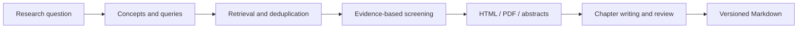

<div align="center">

# Paper Research Agent

**From a research question to a traceable literature review.**

A literature workspace that keeps research materials on your machine: plan queries, find papers, inspect relevance decisions, and draft reviews grounded in source passages.

[](pyproject.toml)
[](frontend/package.json)
[](LICENSE)

[简体中文](README.md) · **English**

[Quick start](#quick-start) · [User guide](document/README.md) · [Architecture](document/ARCHITECTURE.md) · [Contributing](CONTRIBUTING.md)

</div>

---

## Keep the evidence behind the answer

A useful literature review needs more than fluent prose. It needs the queries that were run, the reasons papers were retained, and the passages behind its claims. Paper Research Agent brings those steps into one workspace, preserving retrieval records, screening evidence, source locations, and writing versions.

| Capability | What it provides |
| --- | --- |
| **Start with a question** | Inspect concept groups, alternative branches, synonyms, and search queries generated from a natural-language topic, or supply keywords directly. |
| **See retrieval limits** | Query arXiv and OpenAlex independently, merge duplicate records, and inspect errors, rate limits, truncation, and papers added in each round. |
| **Review screening decisions** | Separate directly relevant papers, supporting reading, pending review, and exclusions, with title/abstract evidence. |
| **Read available source material** | Prefer arXiv HTML full text, then reuse existing local PDFs, then fall back to explicitly labeled original abstracts. |
| **Draft detailed surveys** | Organize thematic chapters, comparison tables, an introduction, and a discussion with stable citation IDs and coverage checks. |
| **Resume saved work** | Retain chapter checkpoints, stop and resume jobs, switch versions, and export Markdown. A separate mode writes shorter Related Work sections. |

The backend uses **FastAPI / Python**, with **LangGraph** in research orchestration. The frontend uses **React / TypeScript / Vite**. Choose an authenticated **Codex CLI** or an **OpenAI-compatible API** as the model backend.



## Quick start

Requirements: **Python 3.11+**, **Node.js 22.12+** (CI uses Node.js 24), and an available model backend. The instructions below run the project from source.

### 1. Install

```bash
git clone https://github.com/zk-yue/paper-research-agent.git
cd paper-research-agent
python3 -m venv .venv
source .venv/bin/activate
python -m pip install --upgrade pip
python -m pip install -e '.[dev]'
```

On Windows PowerShell, activate the environment with `.venv\Scripts\Activate.ps1`. For a new installation, copy `.env.example` to `.env`. Preserve any existing configuration.

### 2. Choose a model backend

**Reuse a Codex CLI login.** Install the CLI separately using the [official OpenAI instructions](https://learn.chatgpt.com/docs/codex/cli). Check authentication as the same operating-system user that will run the backend:

```bash
codex login status
# If needed: codex login
```

Configure `.env`:

```dotenv
LLM_PROVIDER=codex
CODEX_CLI_PATH=codex
CODEX_MODEL=
CODEX_REASONING_EFFORT=medium
CODEX_TIMEOUT=300
```

An empty `CODEX_MODEL` uses the CLI's built-in default. You can specify a model available to your account; reasoning settings must be supported by that model. The adapter uses isolated temporary sessions and ignores model, MCP, and plugin settings from your personal CLI configuration. Do not copy authentication files into this repository. See the [configuration guide](document/README.md#模型配置).

**Use an OpenAI-compatible API.** Replace the key, endpoint, and model name with values for your provider:

```dotenv
LLM_PROVIDER=openai
OPENAI_API_KEY=your-api-key
OPENAI_BASE_URL=https://api.openai.com/v1
OPENAI_MODEL=your-model
```

### 3. Run

```bash
# Terminal 1: repository root, with the virtual environment activated
python -m backend
```

```bash
# Terminal 2
cd frontend
npm ci
npm run dev
```

Open [localhost:5173](http://localhost:5173). API documentation is available at [127.0.0.1:8000/docs](http://127.0.0.1:8000/docs).

Create a research task, inspect its query plan and screening results, then open its review workspace. Detailed surveys do not require manually downloading PDFs or extracting reference cards first. The interface is currently primarily Chinese; surveys support Chinese and English.

<details>
<summary><strong>Use the CLI, or serve a frontend build from the backend</strong></summary>

```bash
paper-research --keywords "robot manipulation" "tactile sensing" --year-from 2024
```

```bash
cd frontend
npm run build
cd ..
python -m backend
```

Open [127.0.0.1:8000](http://127.0.0.1:8000) after building. The Vite development server is no longer needed; the backend must remain running. The legacy entry points `python backend/server.py` and `uvicorn backend.server:app` remain supported.

</details>

## Data and privacy

**Local storage does not mean offline execution.** Search terms are sent to scholarly search services. Topics, abstracts, selected source passages, writing instructions, and any reference templates used are sent to your configured model provider. Data handling, availability, usage limits, and charges depend on that provider.

- Keep `.env`, authentication files, downloaded papers, task history, prompt logs, personal presets, and generated reviews out of public repositories.
- Codex manages its own credentials. The project does not require a repository-local login file or modify your personal CLI configuration.
- Model call logs can contain complete research instructions and source passages. Share only redacted, minimal reproductions in issue reports.
- Set `PAPER_RESEARCH_DATA_DIR` to store runtime data outside the repository. Changing it does not move existing files.

Source checkouts use the project directory for runtime data by default; installed packages use a user data directory. See [data management](document/README.md#数据管理) and the publication guidance in [CONTRIBUTING.md](CONTRIBUTING.md). Ignore rules do not remove files already present in Git history.

## What validation means

Each detailed survey freezes its input and global citation IDs. Checks cover chapter assignments, citations in the actual body, and quoted passages from the same paper and source location. Bibliography entries do not count as body coverage. Model-based semantic reviews examine chapters and the final introduction and discussion; quality notes are retained alongside the draft.

These checks establish **traceability**, not a proof of correctness. Retrieval is bounded by indexes, dates, budgets, and source availability. Abstracts cannot substantiate full-text-only details, and models can misinterpret papers. The application currently targets **one local user and one backend process**. It has no account authentication and does not claim exhaustive retrieval or automatically publication-ready systematic reviews.

Evaluation protocols: [retrieval and screening](document/SEARCH_EVALUATION.md) · [surveys and evidence](document/SURVEY_EVALUATION.md). Personal research tasks and live-run logs are not distributed with the source.

## Development

```bash
python -m ruff check .
python -m ruff format --check .
python -m pytest

cd frontend
npm run lint
npm test
npm run build
```

Default tests use temporary data and mocked HTTP/model responses. They require neither authentication nor live model usage. Live evaluations are separate. Python dependencies are declared in `pyproject.toml`; frontend dependency resolution is captured in `package-lock.json`.

You can also run `make check`. To prepare distributable source artifacts:

```bash
make release-check
```

This checks release files, builds the sdist and wheel, and scans archive contents without uploading anything. The sdist includes backend/frontend source and documentation. The wheel provides the Python API/CLI only, without a built Web UI. Do not archive an entire working directory containing local research data.

| Documentation | Contents |
| --- | --- |
| [User guide](document/README.md) | Search modes, review versions, configuration, data, and troubleshooting |
| [Architecture](document/ARCHITECTURE.md) | Service boundaries, background jobs, storage, and evidence processing |
| [Frontend guide](frontend/README.md) | Development proxy, components, state, and API contracts |
| [Contributing](CONTRIBUTING.md) | Local checks, conventions, and publication checks |
| [Security policy](SECURITY.md) | Vulnerability reporting and deployment boundaries |

Reproducible bug reports, documentation improvements, and focused pull requests are welcome. For quality issues, distinguish source retrieval failures, screening decisions, insufficient evidence, and writing errors so the responsible stage can be investigated.

## License

Project code is licensed under [MIT](LICENSE). Dependencies retain their own licenses. Papers, imported writing examples, and user materials retain their original rights. Personal paper libraries and authentication data are not distributed with the source.
