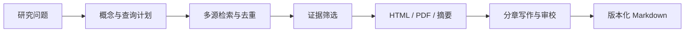

<div align="center">

# Paper Research Agent

**从研究问题到可追溯的文献综述。**

一个在本机管理研究资料的文献工作台：拆解主题、检索论文、审查相关性，并基于原文生成可继续编辑的综述。

[](pyproject.toml)
[](frontend/package.json)
[](LICENSE)

**简体中文** · [English](README.en.md)

[快速开始](#快速开始) · [使用手册](document/README.md) · [架构](document/ARCHITECTURE.md) · [参与贡献](CONTRIBUTING.md)

</div>

---

## 为研究过程保留依据

文献研究需要的不只是一个答案，还需要知道用了哪些查询、为什么保留某篇论文，以及正文结论来自哪里。Paper Research Agent 将这些步骤放进同一个工作区，保留检索记录、筛选证据、原文位置和写作版本。

| 能力 | 你可以做什么 |
| --- | --- |
| **从问题开始** | 输入自然语言主题，查看概念组、同义表达、备选分支与查询词；也支持直接输入关键词。 |
| **看清检索范围** | 分别查询 arXiv 与 OpenAlex，合并重复记录，查看来源错误、限流、截断和各轮新增论文。 |
| **审查筛选理由** | 将直接相关、补充阅读、待复核和排除条目分开展示，保留标题与摘要证据。 |
| **优先读取原文** | 优先访问 arXiv HTML 全文；其次复用已有 PDF，再降级到明确标注的原始摘要。 |
| **生成详细综述** | 按研究问题组织多章正文、比较表、导论和综合讨论，维护固定引用编号并检查引用覆盖。 |
| **继续未完成的工作** | 保存章节检查点；支持停止、恢复、版本切换和 Markdown 导出。另提供短篇 Related Work 模式。 |

后端为 **FastAPI / Python**，研究编排包含 **LangGraph**；前端为 **React / TypeScript / Vite**。模型可选择已登录的 **Codex CLI** 或 **OpenAI 兼容 API**。



## 快速开始

需要 **Python 3.11+**、**Node.js 22.12+**（CI 使用 Node.js 24），以及一种可用的模型后端。以下为源码运行方式。

### 1. 安装

```bash
git clone https://github.com/zk-yue/paper-research-agent.git
cd paper-research-agent
python3 -m venv .venv
source .venv/bin/activate
python -m pip install --upgrade pip
python -m pip install -e '.[dev]'
```

Windows PowerShell 激活环境使用 `.venv\Scripts\Activate.ps1`。首次运行将 `.env.example` 复制为 `.env`；已有 `.env` 时保留原配置。

### 2. 选择模型后端

**使用已有 Codex CLI 登录**：CLI 需要单独安装，参见 [OpenAI 官方安装说明](https://learn.chatgpt.com/docs/codex/cli)。先在运行后端的同一系统用户下确认登录状态。

```bash
codex login status
# 尚未登录时：codex login
```

在 `.env` 中设置：

```dotenv
LLM_PROVIDER=codex
CODEX_CLI_PATH=codex
CODEX_MODEL=
CODEX_REASONING_EFFORT=medium
CODEX_TIMEOUT=300
```

`CODEX_MODEL` 留空使用 CLI 内置默认值；也可填写账户可用的模型。推理强度需要该模型支持。本项目使用独立临时会话，忽略个人 CLI 配置中的模型、MCP 与插件设置；无需把认证文件复制进仓库。详见[模型配置](document/README.md#模型配置)。

**使用 OpenAI 兼容 API**：将 `.env` 改为以下配置，并替换密钥、地址和模型名称。

```dotenv
LLM_PROVIDER=openai
OPENAI_API_KEY=your-api-key
OPENAI_BASE_URL=https://api.openai.com/v1
OPENAI_MODEL=your-model
```

### 3. 启动

```bash
# 终端 1：仓库根目录，激活虚拟环境后
python -m backend
```

```bash
# 终端 2
cd frontend
npm ci
npm run dev
```

打开 [localhost:5173](http://localhost:5173)。后端接口文档位于 [127.0.0.1:8000/docs](http://127.0.0.1:8000/docs)。

首次使用可输入一个研究问题，查看检索计划与筛选结果，再进入任务的“文献综述”生成文稿。详细综述无需先手动下载 PDF 或提取卡片。

<details>
<summary><strong>仅使用 CLI，或由后端提供构建后的前端</strong></summary>

```bash
paper-research --keywords "robot manipulation" "tactile sensing" --year-from 2024
```

```bash
cd frontend
npm run build
cd ..
python -m backend
```

构建后访问 [127.0.0.1:8000](http://127.0.0.1:8000)。前端开发服务器不再是必需的；后端仍需保持运行。源码兼容入口 `python backend/server.py` 和 `uvicorn backend.server:app` 继续可用。

</details>

## 本地数据与隐私

**本地保存不等于离线运行。** 检索词会发送到学术检索服务；主题、摘要、原文选段、写作指令和使用的参考模板会发送到所选模型服务。服务方的数据处理政策、使用额度与费用由你配置的后端决定。

- `.env`、认证文件、下载的论文、任务历史、提示词日志、个人预设和生成文稿均不应进入公开仓库。
- Codex 凭据由 CLI 自行管理；项目不要求在仓库中保存登录文件，也不修改个人 CLI 配置。
- 模型调用日志可能包含完整研究指令和原文选段。分享问题报告时，只提供经过脱敏的最小复现。
- 可以设置 `PAPER_RESEARCH_DATA_DIR` 将运行数据存到仓库之外；现有文件不会自动搬迁。

源码运行默认在项目目录保存数据，安装包运行默认使用用户数据目录。路径与备份方式见[数据管理](document/README.md#数据管理)。发布前的文件、历史和源码包检查见 [CONTRIBUTING.md](CONTRIBUTING.md)。`.gitignore` 无法移除已经进入 Git 历史的文件。

## 结果如何校验

每版详细综述固定输入快照与全局引用编号，检查论文的章节归属、正文引用以及同一论文、同一段落中的原文摘录。正文覆盖率不把参考文献列表中的条目算进去。章节和导论、讨论还会经过模型语义审校，结果与质量提示一并保存。

这些检查提供**可追溯性**，不构成正确性的证明。检索受索引、年份、预算和服务可用性影响；摘要证据不能支持全文独有细节；模型可能误读文献。当前实现面向**本机单用户、单后端进程**，不提供账户认证，也不承诺穷尽检索或自动完成可发表的系统综述。

评估协议：[检索与筛选](document/SEARCH_EVALUATION.md) · [综述与证据](document/SURVEY_EVALUATION.md)。公开仓库不附带个人研究任务和运行日志。

## 开发

```bash
python -m ruff check .
python -m ruff format --check .
python -m pytest

cd frontend
npm run lint
npm test
npm run build
```

默认测试使用临时数据和模拟 HTTP / 模型响应，不依赖登录或真实模型额度。真实联网评估需要单独运行。Python 依赖以 `pyproject.toml` 为准，前端使用 `package-lock.json` 固定依赖解析。

也可以使用 `make check` 执行本地检查。准备分发源码时运行：

```bash
make release-check
```

它检查发布文件、构建 sdist / wheel，并扫描归档内容，不执行上传。sdist 包含前后端源码与文档；wheel 仅提供 Python API / CLI，不包含构建后的 Web UI。不要直接压缩包含本地研究资料的工作目录。

| 文档 | 内容 |
| --- | --- |
| [使用手册](document/README.md) | 检索模式、综述版本、配置、数据与常见问题 |
| [架构说明](document/ARCHITECTURE.md) | 服务边界、后台作业、存储与证据流水线 |
| [前端开发](frontend/README.md) | 开发代理、组件职责、状态与接口 |
| [贡献指南](CONTRIBUTING.md) | 本地检查、变更约定与发布前检查 |
| [安全政策](SECURITY.md) | 漏洞报告与部署边界 |

欢迎提交可复现的问题、文档改进与聚焦的 PR。涉及检索或综述质量时，请区分“来源未检索到”“筛选决定”“证据不足”和“写作错误”，以便定位具体阶段。

## 许可证

项目代码采用 [MIT](LICENSE) 许可证。依赖保留各自许可证；论文、导入的范文和用户资料不因本项目采用 MIT 而改变其权利归属。本项目不随源码分发个人论文库或认证数据。
