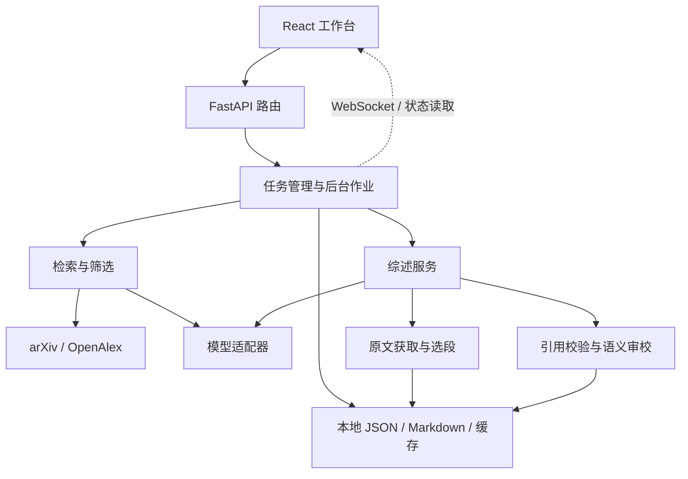

# 架构与运行边界

[项目首页](../README.md) · [使用手册](README.md)

Paper Research Agent 是单用户、单后端进程的本地应用。HTTP 接口负责参数与状态，后台服务执行研究作业，文件保存任务、原文与写作检查点。前端通过状态更新恢复工作区，不持有模型凭据。

## 组件与职责



| 模块 | 边界 |
| --- | --- |
| `backend/app.py`、`backend/routes/` | 生命周期、HTTP、CORS、WebSocket、可选静态前端 |
| `backend/task_manager.py` | 检索作业、共享状态、取消与事件分发 |
| `backend/executor.py`、`backend/deep_search_agent.py` | 关键词与多轮主题研究流程 |
| `backend/retrieval.py`、`tools.py` | 检索来源、查询诊断、匹配去重及模型辅助处理 |
| `backend/review_service.py` | 综述输入快照、后台执行、进度和恢复 |
| `backend/survey_evidence.py` | HTML / 已有 PDF / 摘要的证据准备与选段 |
| `backend/survey_writer.py`、`backend/survey_validation.py` | 分章写作、严格来源校验、审校与文稿组装 |
| `backend/reference_card.py`、`backend/review_writer.py` | 编目卡片与短 Related Work |
| `llm.py`、`codex_llm.py` | 选择模型后端与文本生成接口 |
| `settings.py`、`storage.py` | 数据目录、路径约束与持久化基础设施 |
| `graph.py`、`agents/literature_agent.py` | CLI / LangGraph 文献研究路径 |
| `frontend/src/api/`、`frontend/src/lib/` | 请求与状态协议、可测试的界面逻辑 |

## 请求、作业与事件

创建研究任务先持久化元数据，再由 `TaskManager` 持有异步作业引用。删除、取消和服务关闭会停止相应编排。Python 无法强制中断所有已发出的同步 HTTP / API 请求，这些请求可能持续到自身超时；取消后不得继续启动后续步骤或恢复已删除任务。

事件从工作线程调度到订阅者所属事件循环。订阅队列有上限，慢客户端溢出时收到 `resync_required`，前端重新读取持久化状态。WebSocket 断开不代表研究停止；页面通过任务状态和轮询恢复进度。

综述服务独立保存 review ID、输入快照、阶段、章节和正文。重启将未结束的综述标记为中断，需要显式继续，不会自行重新调用模型。生成中的综述及其所属任务不能删除。Codex 综述调用支持取消令牌，停止时终止子进程组并保留已通过校验的章节。

## 模型与数据边界

业务模块使用 `.invoke(messages)` / `.stream(messages)` 和返回对象的 `.content`。OpenAI 兼容后端使用 LangChain 客户端；Codex 适配器使用独立临时 CLI 会话，从最终响应文件读取正文，避免过程事件进入模型 JSON 结果。

Codex 适配器仅实现项目需要的文本接口，`.stream()` 只返回一次最终结果，不承诺完整 Runnable、图像输入或工具调用能力。会话忽略用户配置中的扩展，禁用 shell、网页搜索、hooks、插件和应用工具；CLI 根据现有用户环境管理认证，项目不需要将凭据复制到仓库。

“本地应用”描述资料与状态的存储位置，并不表示模型离线。主题、查询、摘要、选中的原文片段、写作要求及使用的模板会发往对应检索或模型服务。提示词日志与模型响应会保存到本地，因此也属于需要保护的研究资料。前端不得接收服务端密钥。

## 配置与存储

`settings.py` 在源码运行时采用仓库根目录作为默认数据根；安装包运行使用用户数据目录。`PAPER_RESEARCH_DATA_DIR` 可覆盖运行数据位置，测试在导入业务模块前将其设为临时目录。导入后端不应迁移用户数据；恢复与迁移在 FastAPI lifespan 中进行。

`storage.py` 校验标识符、限制路径位于指定根目录内，并以同目录临时文件加 `os.replace` 原子写入 JSON。单进程锁保护工作线程间的读改写；序列化失败不会截断原文件。损坏 JSON 会产生诊断，不应让其他正常任务不可读取。

运行文件、个人配置、日志、PDF、缓存、模板和导出文稿与可分发源码有不同生命周期。忽略规则用于降低误提交风险，发布检查还应覆盖实际文件集合与构建产物。不要直接压缩整个工作目录作为源码发布包。

目前的内存状态与文件锁只支持一个后端进程。原子替换不等于跨进程事务；增加 Uvicorn workers 会破坏作业和订阅的一致性。多用户或多实例运行需要先设计数据库、持久任务队列和授权机制。

## 检索与筛选

主题规划将用户问题拆为概念与备选分支。检索按查询和来源记录执行参数、返回状态和截断，避免把错误作为零命中。论文匹配合并保留来源与命中查询；年限、引用补检及查询预算共同决定本次候选范围。

筛选保留直接相关、补充阅读、待复核和排除四组，并核对评分依据是否来自对应论文的标题或摘要。相关度描述主题匹配程度，不替代研究质量审查。预算结束、来源失败和仍有待复核应作为不同终止状态呈现。

## 详细综述流水线

```text
输入快照
  → 原文缓存与固定引用编号
  → 全部论文的章节分配
  → 分章写作与严格摘录校验
  → 章节语义审校 / 必要的局部修订
  → 导论与综合讨论
  → 终稿审校
  → Markdown、参考文献与覆盖附录
```

`survey_evidence` 仅对识别出的 arXiv 地址尝试 HTML 全文，保留原始 HTML、解析段落、锚点和来源哈希。请求受限速、超时、大小上限与失败缓存约束；没有 HTML 时回退到已有 PDF，再回退到原始摘要。HTML 保留章节与锚点，PDF 保留物理页码。取消信号也作用于请求前的限速等待。

`survey_writer` 组织 6–10 个主题章节，少于 6 篇时相应减少；同时写作的章节上限为 2。每章按主题选取方法、实验和局限等片段，成功结果分别保存。旧卡片仅辅助编目，不替代原文。恢复时校验输入和来源签名，避免不同论文或模型配置混入同一版本。

`survey_validation` 检查全局引用编号、章节归属、正文覆盖与同篇同段摘录。参考列表、代码、数学和普通链接不应被误计为正文引用。有限的转义修复只接受同一段落中唯一、连续的原文匹配，并记录修复前文本与来源位置；不会通过修改数字、借用其他论文或拼接句子来放宽校验。

模型语义审校用于寻找明确的事实矛盾、实验口径错误和跨论文混淆。明确错误触发局部修订；无法修复时保留文稿并报告失败。编辑建议和证据边界可以作为质量提示保留。

## 校验的含义与限制

来源身份和逐字摘录校验不能证明摘录支持正文中的每一个推论；模型语义审校也可能遗漏问题。需要将作者报告、综述推断与研究建议区分开。正文覆盖率的分母是本次选定论文，不是领域全部文献。

当前按主题选取有限原文片段，没有保证全文所有信息进入每章上下文。资料未出现在某章选段，不等于论文未做相应实验。摘要资料不得被描述为已完成全文核验。完整评估方法见[综述评估协议](SURVEY_EVALUATION.md)。

## 演进方向

有价值的后续工作包括：继续拆分 `tools.py` 中的独立职责；为关键用户流程补充浏览器级测试；按正文中的证据缺口定向补读原文；在引入多用户需求前设计持久任务队列和数据授权。变更应首先保护来源追踪、旧数据兼容与恢复语义，避免仅以新增抽象或并发数量衡量改进。
